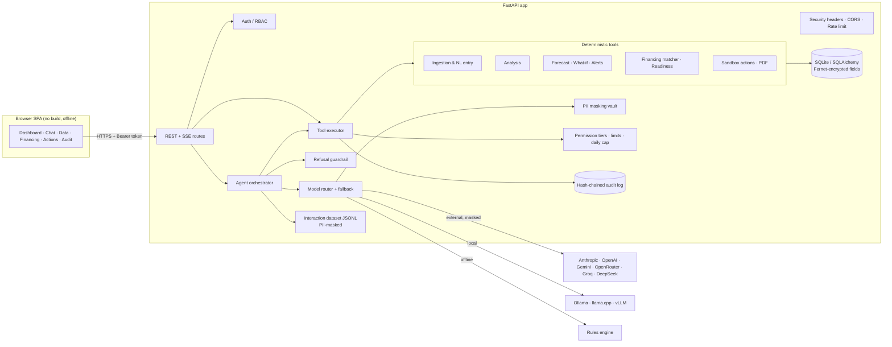
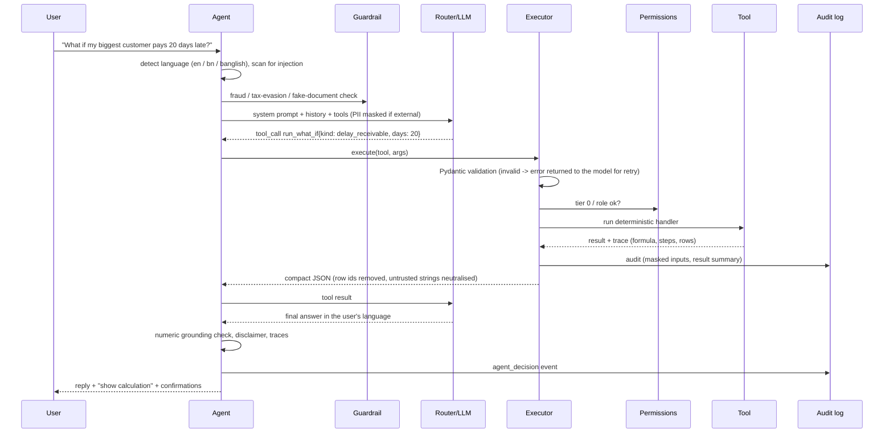
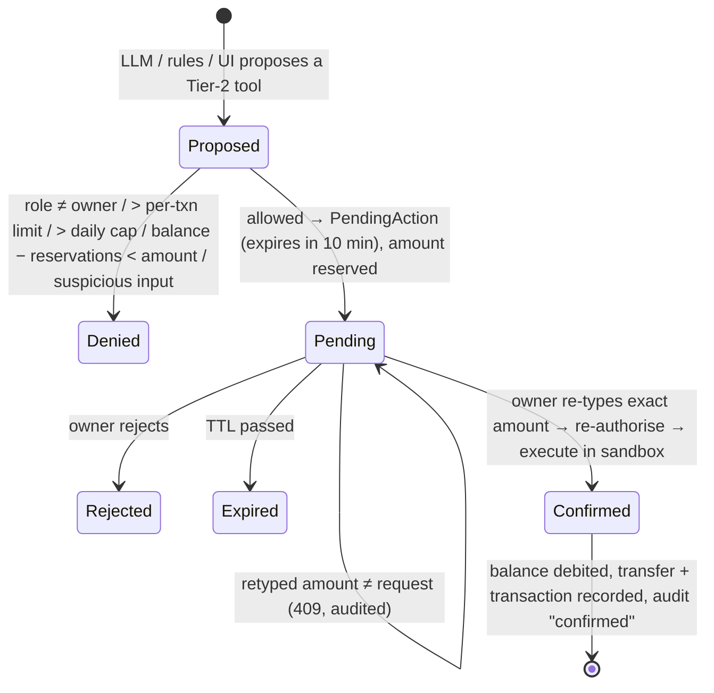

# SME Finance Copilot: Technical Documentation

FinTechathon 2026, International Track, Topic E (SME Finance Copilot). Target market: Bangladesh SMEs.

## 1. Design principles

1. **The LLM never does arithmetic.** Totals, margins, forecasts, EMI, DSCR, break-even, aging and eligibility
   are computed by deterministic, unit-tested Python. The model only understands the request, chooses tools,
   and explains tool results. Every number shown to the user carries a *trace*: the formula, the steps and the
   source rows.
2. **Security is enforced in code, not in the prompt.** Every tool call, whether it came from an LLM, the
   offline engine or a UI button, passes one pipeline: schema validation, permission tier and role check,
   limits, human confirmation for money, then a hash-chained audit entry.
3. **Works offline, and the model is swappable.** One `LLMProvider` interface covers five vendor adapters plus a
   deterministic offline engine. Models switch per request, with automatic fallback.
4. **Local relevance.** English, Bangla and Banglish input and replies; lakh/crore formatting; bKash, Nagad and
   Rocket statements; Eid, Pohela Boishakh and harvest seasonality; Bangladesh SME financing types; VAT/TIN/trade
   licence awareness.

## 2. System architecture

| Layer | Module | Responsibility |
|---|---|---|
| Presentation | `frontend/` | SPA: dashboard charts, chat with SSE streaming, confirmations, audit viewer. No `innerHTML`, strict CSP |
| API | `sme_copilot/api/` | Auth, chat, tools, data, insights, actions, privacy; Pydantic request validation |
| Agent | `sme_copilot/agent/` | Language detection, guardrails, model loop, tool registry and executor, numeric grounding, offline intent engine |
| Providers | `sme_copilot/llm_providers/` | Unified interface, 6 adapters, router, structured output and tool-call emulation |
| Domain tools | `tools/`, `forecasting/`, `financing_catalog/`, `sandbox/` | All financial computation and actions |
| Security | `sme_copilot/security/` | Auth, permissions, audit chain, PII, crypto, injection defence, refusal guardrails, HTTP hardening |
| Data | `models.py`, `db.py` | 17 tables; append-only audit table protected by SQLite triggers |
| Ops | `benchmarks/`, `telemetry/`, `demo/`, `cli.py` | Benchmark harness, dataset export, seed, scripted evidence |

## 3. Agent loop

Details:

- **Steps.** At most 6 model calls and 4 tool calls per step. History is capped at 8 messages.
- **Tool calling.** Native tool calling is used where the model supports it. Models flagged `tools: emulated` get
  the tool list in the prompt and must reply with one strict JSON envelope
  (`{"action": "call_tool", ...}` or `{"action": "final", ...}`), which is validated and retried up to twice
  with the error message (`llm_providers/structured.py`).
- **Structured output.** `structured_chat()` uses native JSON mode where available (OpenAI `json_schema`,
  Gemini `responseSchema`, Anthropic forced tool), otherwise prompt-instructed JSON. Every output is parsed
  with a balanced-brace extractor and validated against a Pydantic schema, with retry.
- **Offline engine.** `RulesProvider` implements the same interface. `plan()` maps EN/BN/Banglish keywords
  and regexes to tool calls; `compose()` writes templated answers in the user's language from tool results
  only. It is the default demo model, the last link of every fallback chain, and the benchmark baseline.
- **Numeric grounding.** Every number in the final reply (handling ৳, commas, lakh/crore words, %, Bangla
  digits) must match a number in the tool outputs, allowing for rounding, lakh scaling and ratio-to-percent
  conversion. Unmatched numbers are shown to the user as "could not verify" and counted as hallucinations in
  the benchmark.

## 4. LLM provider abstraction

`LLMProvider.chat(messages, tools, json_schema, temperature, max_tokens)` returns a `ChatResponse` with
content, tool calls, usage, latency and TTFT. Adapters also provide `stream()`, `count_tokens()` and
`estimate_cost()`. Retries use exponential back-off on 408, 409, 429, 5xx and network errors; 4xx auth errors
fail fast.

| Adapter | Wire format | Notes |
|---|---|---|
| `anthropic` | Messages API | Merges consecutive tool results into one user turn; structured output via forced tool |
| `openai` | Chat Completions | `max_completion_tokens`, `json_schema` response format |
| `gemini` | `generateContent` / SSE | Schemas inlined (no `$ref`), `nullable` for optional fields |
| `openai_compatible` | Chat Completions | OpenRouter, Groq, DeepSeek, Together, vLLM, llama.cpp; `json_object` mode |
| `ollama` | OpenAI-compatible `/v1` | Local by default (`external: false`) |
| `rules` | in-process | Deterministic offline engine |

Routing (`providers.yaml → routing`): tasks such as `classification`, `extraction`, `categorization` and
`advisory` can map to different profiles. The fallback chain is tried in order and ends in `rules-offline`.
External profiles are refused when `LOCAL_ONLY_MODE=true`. For external profiles, a per-request `PIIVault`
replaces phones, accounts, NID, TIN, emails and cards with placeholders such as `[PHONE_1]`, and restores
them locally in the reply and in tool arguments.

## 5. Core algorithms

### 5.1 Ingestion (`tools/ingestion.py`)
- CSV, TSV, XLSX or pasted text. The real header row is detected in the first 15 rows, so bank preambles are
  skipped. Columns are mapped through an English and Bangla synonym table (exact matches first, then
  containment).
- Supported layouts: ledger, bank statement (debit/credit), wallet statement (transaction type, fee, status),
  and invoices.
- Wallet types (`Cash In`, `Send Money`, `Payment`, …) map to a direction and category. Fees become separate
  `mobile_fees` rows. Failed rows are skipped and reported.
- Amounts are parsed from `৳1,20,000`, `Tk 500`, `(2,000)` and Bangla digits. Dates are parsed day-first.
- Phone or account numbers found in name columns move into the encrypted `account_ref`, and the display name
  is masked.
- Each row keeps `batch_id` and `source_row` for traceability, and a file is only ever imported once (SHA-256).

### 5.2 Natural-language entry (`tools/nl_entry.py`)
Handles English, Bangla and Banglish: Bangla digits, multipliers (`k`, `hazar`, `হাজার`, `lakh`, `লাখ`,
`crore`) and quantities (`12 shirts`, `১২টা`). Dates and phone numbers are blanked out before amounts are
read. Explicit verbs (`sold`, `paid`, `dilam`, `বিক্রি`) set the direction, and the longest keyword sets the
category. The parser also extracts channel (cash, bKash, Nagad, Rocket, bank, card), relative dates
(`gotokal`, `গতকাল`) and counterparty (`from X`, `X ke`). It returns a confidence score and the list of
missing fields.

### 5.3 Data quality (`tools/quality.py`)
- **Duplicates.** Same direction and amount, and either the same reference, or same date and description, or
  ≤ 1 day apart with ≥ 0.85 description similarity. Detected within a batch and against existing rows,
  bucketed so it stays roughly O(n). Duplicates are flagged and excluded from analysis.
- **Anomalies.** Robust z-score per category, `0.6745·(x−median)/MAD > 3.5` and `x > 2×median`. Sparse
  categories are compared with the overall outflow median (> 5× and > ৳50,000). A first payment to a new
  counterparty in the top 10% of outflows within the last 60 days is also flagged.

### 5.4 Financial analysis (`tools/analysis.py`, `tools/finance_math.py`)
| Metric | Formula |
|---|---|
| Gross margin | (revenue − COGS) / revenue; COGS = stock purchases (cash basis) |
| Net operating margin | (revenue + other income − COGS − variable − fixed) / revenue; loan repayments, capex and drawings reported separately |
| Break-even | monthly fixed costs / (1 − (COGS + variable) / revenue); margin of safety |
| Aging | outstanding = amount − paid; buckets not due / 1–30 / 31–60 / 61–90 / 90+; DSO = outstanding / (90-day sales / 90) |
| Cost drivers | category share and change vs the previous equal-length period |
| Seasonality | month revenue / average; peaks and lows explained with the BD festival calendar; upcoming events with last year's uplift |
| Explain change | per-category and per-customer deltas between periods, written as sentences |
| EMI (reducing) | P·r·(1+r)ⁿ / ((1+r)ⁿ − 1), r = annual/12 |
| EMI (flat) | (P + P·rate·n/12) / n |
| Effective APR | IRR (bisection) of instalments against cash actually received (principal − fees) × 12 |
| DSCR | monthly operating cash flow / monthly debt service |

### 5.5 Cash-flow forecast (`forecasting/forecast.py`)
`balance[t] = balance[t−1] + baseline_in[t] − baseline_out[t] + scheduled[t]`, for 30, 60 or 90 days.
- **Scheduled.** Open receivables arrive on due date + that customer's historical average delay (overdue
  ones within 7–21 days; more than 90 days overdue counted at 50%). Payables leave on their due date.
  Recurring obligations come from explicit entries or are auto-detected from history (≥ 3 of the last 4
  months, amounts within ±35%).
- **Baseline.** Built from the last 90 days. Sales not explained by invoice collections, plus other income.
  New credit-sale collections at the historical rate, but only after the typical issue-to-payment lag. Outflows
  are split into variable (scaling with sales in what-ifs) and fixed/other; categories covered by obligations
  are excluded. A seasonal factor comes from last year's same month.
- **Uncertainty.** 80% band = ±1.28·σ(weekly net cash flow)·√(t/7).
- **Outputs.** Daily series, 30/60/90 summaries, lowest point, first date below zero and below the safety
  level, runway, and the scheduled items list. All are traceable.

### 5.6 What-if (`forecasting/whatif.py`)
Scenarios modify a copy of the forecast inputs. Both versions are projected and compared on end balance,
minimum, first negative date, EMI and explanation sentences. Supported scenarios: a customer (or the biggest
one) paying N days late; a loan with its EMI schedule; sales ±%, with variable costs following; a category cost
± % or a new monthly cost such as hiring; a one-off inflow or outflow.

### 5.7 Alerts and digest (`forecasting/alerts.py`, `digest.py`)
Alert types: low balance or shortfall within 30 days, overdue invoices (critical after 60 days), supplier
bills due, obligations due within 7 days, compliance dates within 10 days (configured and marked "verify"),
unusual payments, category spending spikes (> 1.5× the 3-month average), and seasonal preparation. Alerts
are upserted by dedupe key, auto-resolved when the condition clears, and stay dismissed once dismissed. The
digest adds KPIs and **one-click suggested actions** that call the same audited tools.

### 5.8 Financing matcher (`financing_catalog/`)
The catalog lives in schema-validated YAML (12 product types, every figure illustrative and marked
`verified: false`). For each product:
1. **Hard and soft rules** on the business's real metrics: age, 6-month revenue, revenue CV, months of
   records, trade licence, TIN, bank account, women-led, minimum amount, collateral coverage, and open
   receivables (for invoice financing). Each rule produces a sentence.
2. **Affordability.** The largest principal that keeps DSCR ≥ the product minimum at the mid rate:
   `max EMI = op. cash flow / min DSCR − existing debt service`, inverted through the EMI formula.
3. **Offer** = min(request, product maximum, DSCR capacity, invoice advance, supplier limit). The binding
   constraint is named.
4. **Cost** at the min, mid and max rate: EMI, total repayment, total cost of credit, effective APR.
5. **Fit score** = cost 40 + DSCR headroom 20 + amount fit 20 + speed 10 + no collateral 10, with a 20%
   penalty when the purpose doesn't match.

Every product appears either as a recommendation (with reasons and cautions) or as a rejection (with the
failed rules).

### 5.9 Loan-readiness score
Eight components totalling 100 points: business age 10, record keeping 15, revenue stability 15,
profitability 15, DSCR 15, documentation 15, receivables health 10, collateral 5. Each comes with a
point-valued improvement tip.

### 5.10 Language detection
**Bangla** when the share of Bangla script letters and vowel signs (excluding digits and ৳) among script
characters is ≥ 0.3. **Banglish** when Latin text contains Banglish marker words (`ami`, `koto`, `dilam`,
`lagbe`, `tagada`, …). Otherwise **English**. Replies (both LLM prompts and offline templates) follow the
detected language; Bangla uses Bangla digits and lakh grouping.

## 6. Action layer and human-in-the-loop

- There is **no tool** for confirming. Confirmation is only possible through
  `POST /api/actions/{id}/confirm`, which requires an owner session and the re-typed amount.
- Tier-2 handlers raise `PermissionError` unless they are running inside `confirm_pending()`, as defence in
  depth.
- Tier-1 actions:
  - `create_payment_reminder` (simulated outbox),
  - `draft_invoice_followup` (deterministic EN/BN templates),
  - `generate_loan_report` (reportlab PDF with a forecast chart, SHA-256 recorded),
  - `prepare_loan_checklist`,
  - `add_obligation`, `schedule_alert`, `add_transaction`, `acknowledge_alert`.

## 7. Data model (main tables)

`businesses`, `users`, `auth_sessions` (SHA-256 of tokens), `import_batches`, `transactions` (source batch
and row, flags, encrypted `account_ref`), `invoices` (encrypted phone), `obligations`, `alerts`, `reminders`,
`drafts`, `reports`, `sandbox_accounts`, `sandbox_transfers`, `pending_actions`, `audit_events`
(append-only, hash-chained, no foreign key so it survives data deletion), `conversations`, `chat_messages`.

## 8. API overview

| Area | Endpoints |
|---|---|
| Auth | `POST /api/auth/login`, `POST /api/auth/logout`, `GET /api/auth/me` |
| Copilot | `POST /api/chat`, `POST /api/chat/stream` (SSE: `tool`, `delta`, `done`), `POST /api/feedback`, `GET /api/models` |
| Tools | `GET /api/tools`, `POST /api/tools/{name}` (same pipeline as the agent) |
| Data | `POST /api/data/upload`, `/paste`, `/entry`, `/entry/preview`; `GET /api/data/transactions` (`?ids=` for trace rows), `PATCH …/{id}`, `GET /api/data/invoices`, `/imports` |
| Insights | `GET /api/dashboard`, `/forecast`, `/alerts`, `/digest`; `POST /api/whatif`, `/alerts/{id}/{action}`; `GET/PATCH /api/settings` |
| Actions | `GET /api/actions/pending`, `POST /api/actions/{id}/confirm`, `/reject`; `GET /api/reminders`, `/drafts`, `/reports`, `/reports/{id}/download`, `/sandbox`, `/obligations`, `/compliance` |
| Audit | `GET /api/audit`, `/audit/verify`, `/oplog`, `/oplog/export?fmt=csv\|jsonl` |
| Privacy | `POST /api/privacy/delete`, `GET /api/privacy/export` |

Interactive OpenAPI docs are at `/api/docs` (disabled in production).

## 9. Security design (summary)

Full analysis: [SECURITY_ASSESSMENT.md](SECURITY_ASSESSMENT.md).

- **Tiers** 0–3 enforced in `security/permissions.py`, with roles owner (≤ 2), accountant (≤ 1) and viewer (0).
- **Money controls.** Human confirmation with a re-typed amount, per-transaction limit, daily cap including
  reservations, available balance net of pending reservations, 10-minute expiry, no replay, re-authorisation
  at execution time, and sandbox only.
- **Audit.** SHA-256 hash chain over canonical JSON, SQLite triggers blocking UPDATE and DELETE,
  `verify_chain` re-reading storage, and PII masked before storage.
- **Data protection.** PII masking before external LLMs, local-only mode, Fernet field encryption, deletion
  and export endpoints, and a PII-masked interaction dataset.
- **Prompt injection.** Uploaded rows are scanned and flagged. Untrusted strings are neutralised before
  reaching the model. A system-prompt data-not-instructions rule is in place. Tier-3 tools are registered so
  attempts get audited. Suspicious user messages disable Tier-2 tools for that turn.
- **Web.** bcrypt passwords, opaque tokens (hashed at rest), lockout after 5 failures, rate limits, strict
  CSP, no `innerHTML`, `nosniff`, `X-Frame-Options: DENY`, HSTS over HTTPS, and upload type and size limits.
- **Responsible AI.** A deterministic refusal guardrail for fraud, fake documents, tax evasion, laundering and
  bribery in three languages. Disclaimers on advisory output. Forecast bands and "illustrative / verify" labels
  everywhere.

## 10. Quality and evaluation

- **219 automated tests**, 91% line coverage: finance math against textbook values, analysis against
  hand-computed fixtures, mocked HTTP for every provider, schema tests for every tool, the permission matrix,
  audit tampering, injection and guardrail cases, API, SSE, and end-to-end action flows. See
  [TEST_REPORT.md](TEST_REPORT.md).
- **Benchmark harness** with a 48-scenario golden set; ground truth always comes from the deterministic tools.
  See [benchmarks/results/summary.md](../benchmarks/results/summary.md).
- **Execution evidence**: a scripted 33-step run with exported operation logs. See
  [EXECUTION_EVIDENCE.md](EXECUTION_EVIDENCE.md).
